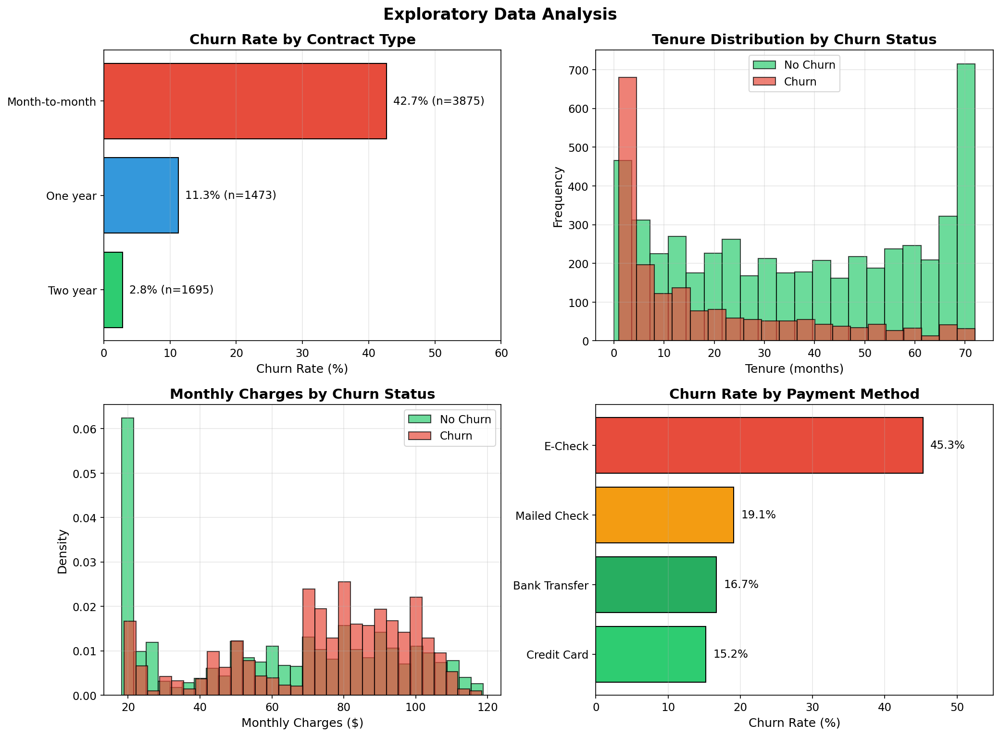
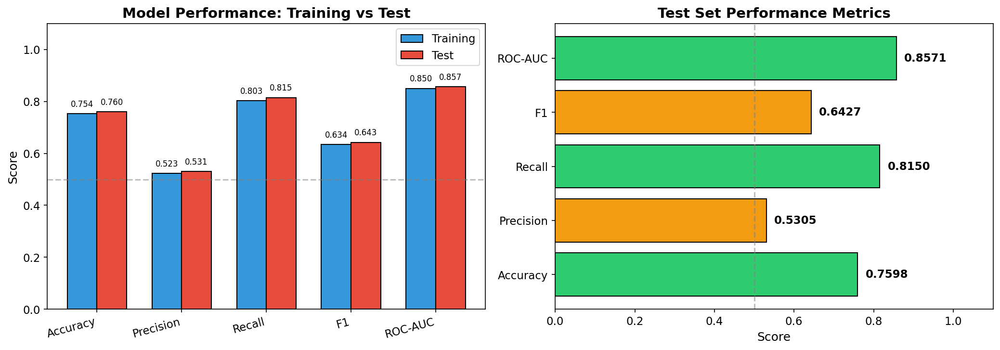
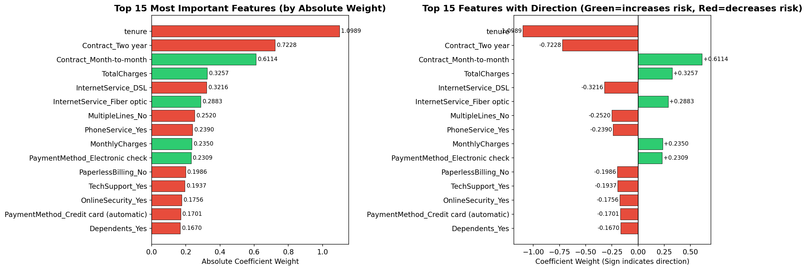
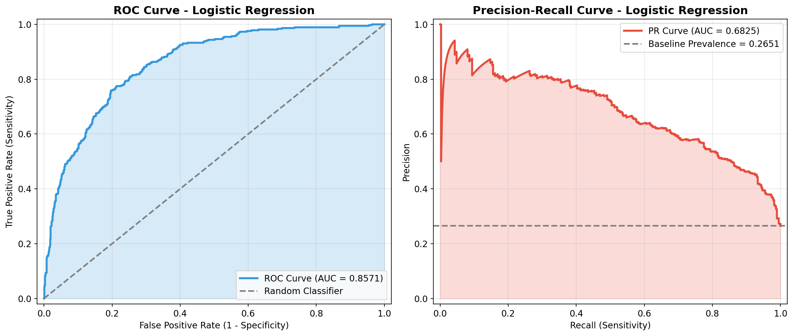
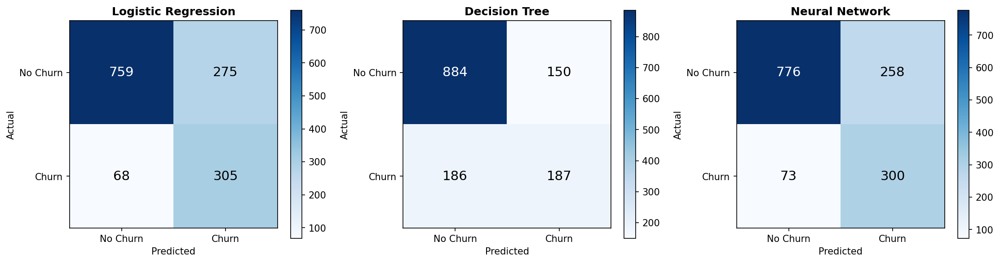
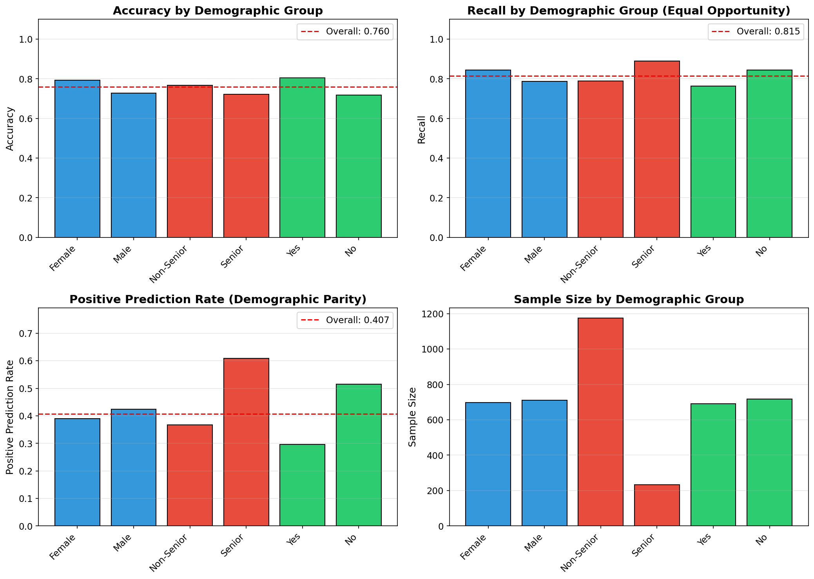

# Telecom Customer Churn Prediction

> **End-to-end machine learning pipeline** built entirely from scratch (no scikit-learn, no PyTorch) to predict customer churn in the telecommunications industry.


---

## Overview

Customer churn — when subscribers leave a telecom provider — costs the industry **billions annually**. Acquiring a new customer costs 5–7× more than retaining an existing one, making accurate early detection a critical business priority.

This project builds a complete ML pipeline on the [IBM Telco Customer Churn dataset](https://www.kaggle.com/datasets/blastchar/telco-customer-churn) (7,043 customers, 21 features) and answers:

- **Which customers are most at risk of churning?**
- **What are the strongest predictors of churn?**
- **Are predictions fair across demographic groups?**

All three classification models — Logistic Regression, Decision Tree, and a Multi-Layer Perceptron — were **implemented from scratch using only NumPy**, demonstrating deep algorithmic understanding beyond API usage.

---

## Key Results

| Model | Accuracy | ROC-AUC | F1 (Churn) | Recall (Churn) |
|---|---|---|---|---|
| **Logistic Regression** ⭐ | **76.0%** | **0.857** | **0.643** | **0.815** |
| Decision Tree | 75.4% | 0.754 | 0.580 | 0.501 |
| Neural Network (MLP) | 76.0% | 0.839 | 0.641 | 0.804 |

> **Logistic Regression** was selected as the best overall model — highest ROC-AUC (0.857) and strong recall (0.815), meaning it correctly identifies 81.5% of customers who will churn. The 95% bootstrap confidence interval for ROC-AUC is **[0.819, 0.866]**.

---

## Visualisations

<table>
  <tr>
    <td align="center"><b>Exploratory Data Analysis</b></td>
    <td align="center"><b>Model Performance</b></td>
  </tr>
  <tr>
    <td></td>
    <td></td>
  </tr>
  <tr>
    <td align="center"><b>Feature Importance (LR Coefficients)</b></td>
    <td align="center"><b>ROC & Precision-Recall Curves</b></td>
  </tr>
  <tr>
    <td></td>
    <td></td>
  </tr>
  <tr>
    <td align="center"><b>Confusion Matrices (All Models)</b></td>
    <td align="center"><b>Fairness Analysis by Demographic Group</b></td>
  </tr>
  <tr>
    <td></td>
    <td></td>
  </tr>
</table>

---

## Top Churn Drivers

Based on Logistic Regression coefficient analysis:

| Feature | Effect on Churn |
|---|---|
| **Contract type: Month-to-month** | ↑ Strongly increases churn risk |
| **Tenure (months)** | ↓ Longer tenure = lower churn risk |
| **Contract type: Two-year** | ↓ Strongly decreases churn risk |
| **Payment method: Electronic check** | ↑ Increases churn risk |
| **Internet service: Fiber optic** | ↑ Moderate increase in churn risk |
| **Internet service: DSL** | ↓ Decreases churn risk |

**Business recommendations:**
- Target month-to-month subscribers with loyalty incentives and contract upgrade offers
- Implement early engagement programmes for customers in their first 6 months
- Investigate friction with electronic check payment — encourage auto-pay enrolment
- Review pricing for Fiber optic plans relative to perceived value

> ⚠️ **Note:** All findings represent correlations, not causal relationships. Business decisions should be informed by domain expertise and controlled experimentation.

---

## Technical Highlights

### Algorithms Implemented From Scratch

**Logistic Regression**
- Gradient descent optimisation with configurable learning rate and iterations
- Sigmoid activation, binary cross-entropy loss
- L2 regularisation support

**Decision Tree**
- Recursive binary splitting using Gini impurity / information gain
- Configurable max depth and minimum samples per leaf

**Multi-Layer Perceptron (MLP)**
- Fully-connected feedforward network
- Backpropagation with sigmoid activations
- Mini-batch gradient descent

### Statistical Validation

- **5-fold stratified cross-validation** — confirms models generalise beyond a single split
- **Bootstrap confidence intervals** (1,000 iterations) — quantifies uncertainty in all reported metrics
- **Determinism checks** — models produce identical outputs given the same random seed

### Fairness & Ethics

- **Disparate Impact analysis** across gender, age group (senior / non-senior), and partner status
- **Intersectional fairness** (e.g. Female × Senior subgroups)
- Flags any group whose positive prediction rate falls outside the **0.8–1.25 threshold** (EEOC four-fifths rule)
- Mitigation strategies proposed for identified disparities

### Software Engineering Practices

- **Unit-tested metric functions** (accuracy, precision, recall, F1, ROC-AUC) — all 6 tests pass
- Custom implementations verified against known ground-truth cases
- Clean, modular notebook structure with clearly labelled sections
- All hyperparameters documented and justified

---

## Project Structure

```
telecom-customer-churn-ml/
│
├── notebooks/
│   └── telecom_churn_prediction.ipynb   # Main notebook (end-to-end pipeline)
│
├── data/
│   └── WA_Fn-UseC_-Telco-Customer-Churn.csv   # Raw dataset (7,043 rows × 21 cols)
│
├── results/                             # All saved plots and figures
│   ├── eda_plots.png
│   ├── model_performance.png
│   ├── feature_importance.png
│   ├── roc_pr_curves.png
│   ├── confusion_matrices.png
│   ├── fairness_analysis.png
│   ├── calibration_curves.png
│   ├── confidence_analysis.png
│   └── ...
│
└── requirements.txt
```

---

## Getting Started

### Prerequisites

```
python >= 3.9
```

### Installation

```bash
# Clone the repository
git clone https://github.com/<your-username>/telecom-customer-churn-ml.git
cd telecom-customer-churn-ml

# Install dependencies
pip install -r requirements.txt
```

### Run the Notebook

```bash
jupyter notebook notebooks/telecom_churn_prediction.ipynb
```

Execute all cells top to bottom. Expected runtime: **2–3 minutes**.

---

## Dataset

**IBM Telco Customer Churn** — publicly available on [Kaggle](https://www.kaggle.com/datasets/blastchar/telco-customer-churn).

| Property | Value |
|---|---|
| Samples | 7,043 customers |
| Features | 21 (17 categorical, 3 numeric, 1 target) |
| Target | `Churn` — Yes (26.5%) / No (73.5%) |
| Class imbalance | ~1:2.8 (churn : non-churn) |

Key features include: tenure, contract type, internet service type, monthly charges, total charges, payment method, and a range of add-on service subscriptions.

---

## Requirements

```
numpy>=1.24.0
pandas>=2.0.0
matplotlib>=3.7.0
jupyter>=1.0.0
```

> All ML algorithms are implemented using **NumPy only** — no scikit-learn, no PyTorch, no TensorFlow.

---

## References

1. IBM. (2018). *Telco Customer Churn Dataset*. Kaggle. https://www.kaggle.com/datasets/blastchar/telco-customer-churn
2. Ahmad, A. K., Jafar, A., & Aljoumaa, K. (2019). Customer churn prediction in telecom using machine learning in big data platform. *Journal of Big Data*, 6(1), 1–24.
3. Vafeiadis, T., et al. (2015). A comparison of machine learning techniques for customer churn prediction. *Simulation Modelling Practice and Theory*, 55, 1–9.
4. Dwork, C., et al. (2012). Fairness through awareness. *ITCS 2012*, 214–226.
5. Reichheld, F. F., & Schefter, P. (2000). E-loyalty. *Harvard Business Review*, 78(4), 105–113.
6. VanderPlas, J. (2016). *Python Data Science Handbook*. O'Reilly Media.

---


## License

This project is licensed under the MIT License — see [LICENSE](LICENSE) for details.
